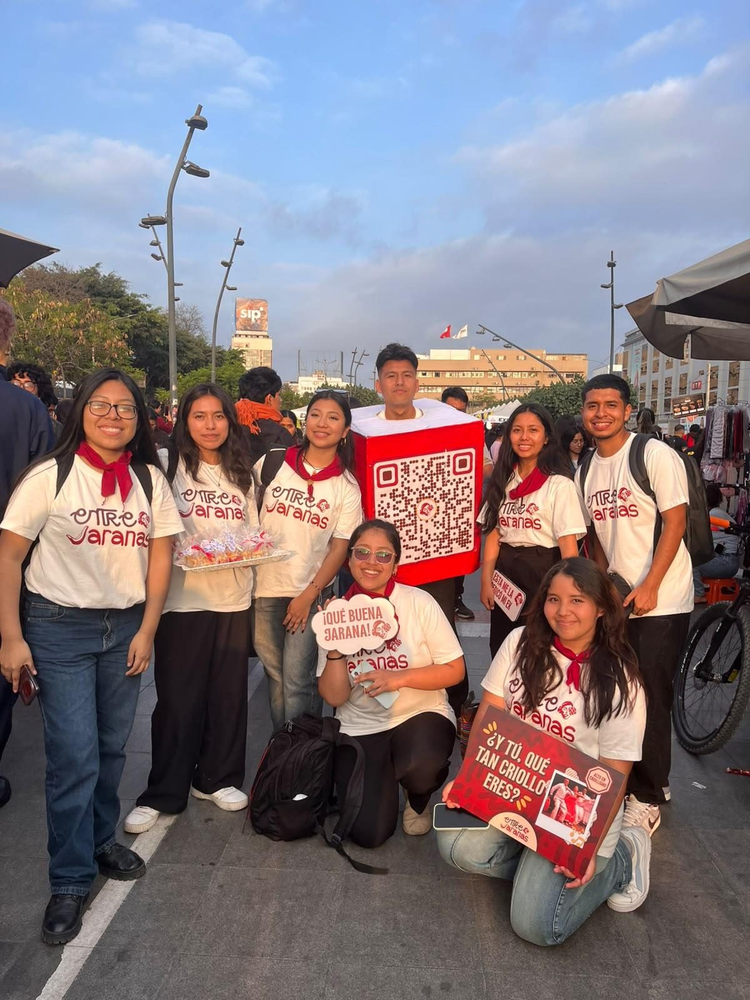
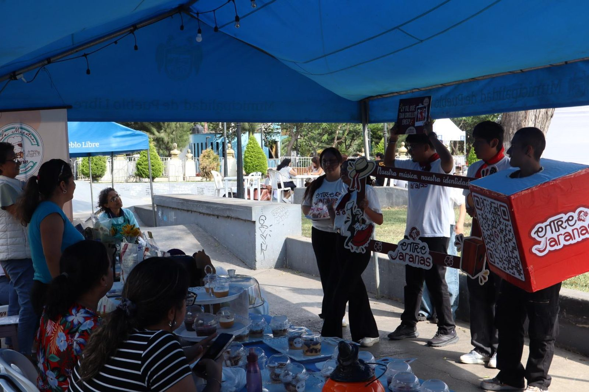
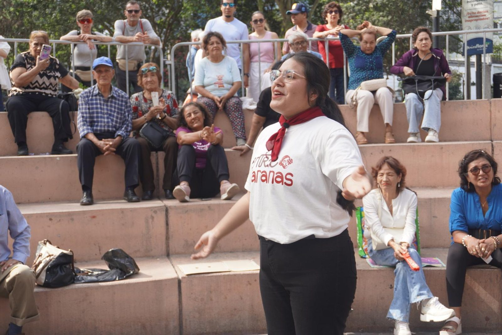
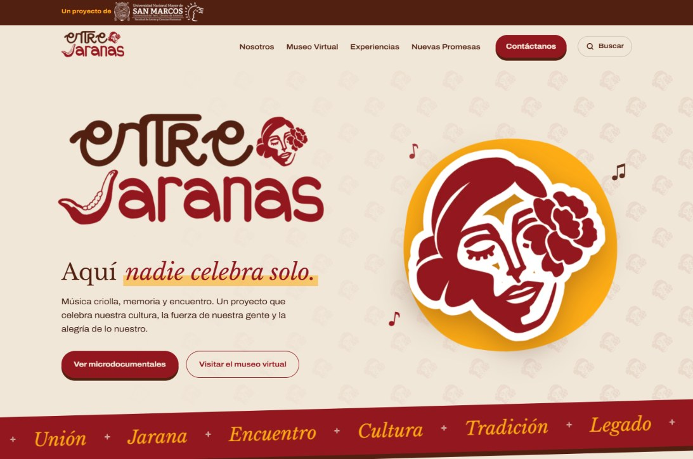
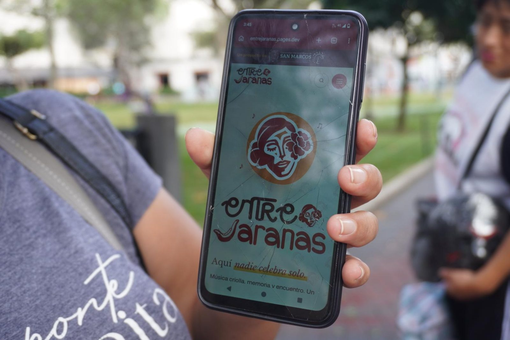

**LIMA, 31 DE OCTUBRE DE 2026.**

Entre música, danzas y el sabor de los dulces tradicionales, _Entre Jaranas_ realizó con éxito un recorrido de difusión por distintas celebraciones del Día de la Canción Criolla. El proyecto, desarrollado por estudiantes del octavo ciclo de Comunicación Social de la Universidad Nacional Mayor de San Marcos, encontró en estas festividades una oportunidad para acercar su plataforma digital a quienes disfrutan y mantienen viva la tradición.

Las actividades de difusión se desarrollaron por la tarde, alrededor de las 2:00 p. m. El equipo conversó con los asistentes y los invitó a explorar la página web mediante un código QR. Además, obsequió miniturrones a quienes comenzaron a seguir el proyecto en redes sociales, sumando un detalle dulce al encuentro.

## Un recorrido por la música y la tradición

En Breña, los estudiantes llevaron _Entre Jaranas_ a la avenida 28 de Julio, donde compartieron con los peatones mediante dinámicas de preguntas sobre música y obsequiando turrones a quienes se animaran a participar. Esta interacción permitió presentar el proyecto y conversar sobre el criollismo en un espacio cotidiano. Por su parte, la 28.ª edición de la feria Emprende Libre, en el parque 3 de Octubre de Pueblo Libre, combinó emprendimientos con una programación musical que anunció a Lucía de la Cruz, Caballeros de Oro, Marco Polo Campos, Pilar Monteiro y Giani Méndez, entre otras voces.

El recorrido continuó en Los Olivos, en la alameda de la municipalidad, donde se integraron gastronomía, emprendimientos y música criolla en un ambiente familiar. También incluyó la Fiesta de los Dulces Criollos, frente al parque Kennedy, en Miraflores. La tradición destacó con la participación de bailes criollos. En estos espacios, el equipo invitó a los asistentes a conocer la plataforma y explorar sus contenidos sobre música y tradiciones.

El contacto directo también permitió mostrar los contenidos de _Entre Jaranas_: un museo virtual, microdocumentales, un mapa de nuevos intérpretes y talleres jaraneros. Así, el simple gesto de escanear el código QR se convirtió en una oportunidad para descubrir historias, artistas y expresiones culturales desde el celular.

Al cierre del recorrido, se cumplió la intención del día: dar a conocer su página web a todos los interesados en mantener viva esta tradición, en especial a los jóvenes que están poco familiarizados con esta cultura y con el género musical. _Entre Jaranas_ registró un incremento considerable de seguidores en sus redes sociales. La respuesta del público acompañó el propósito de esta iniciativa estudiantil: hacer que la cultura criolla encuentre nuevos espacios de encuentro y difusión.

Bajo el lema _“Que lo nuestro siga sonando”_, _Entre Jaranas_ invita a continuar esta experiencia en [entrejaranas.pages.dev](https://entrejaranas.pages.dev/).
