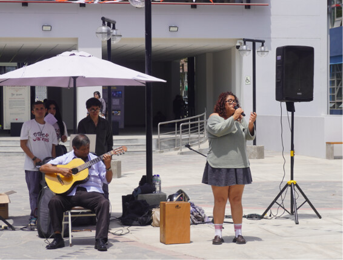
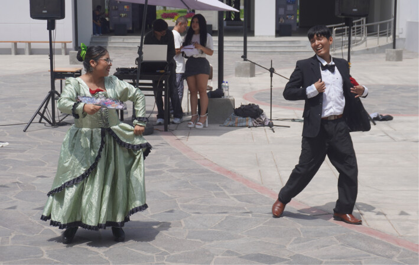
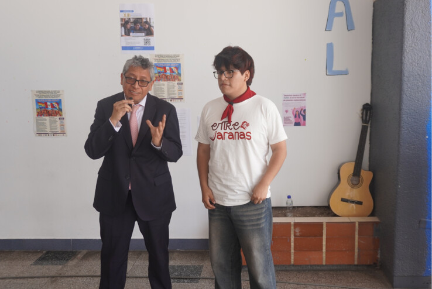
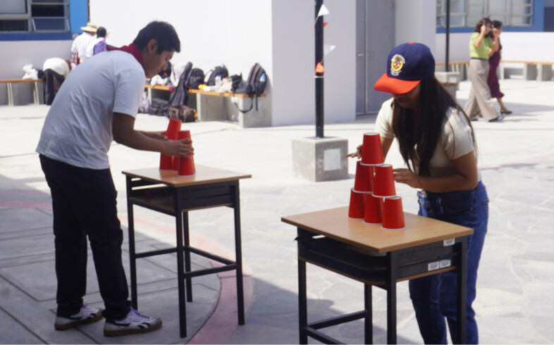
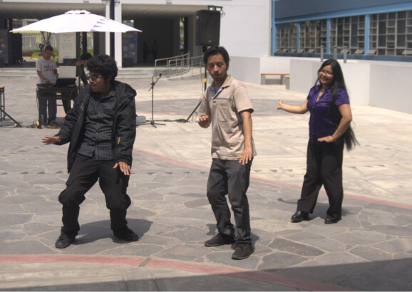
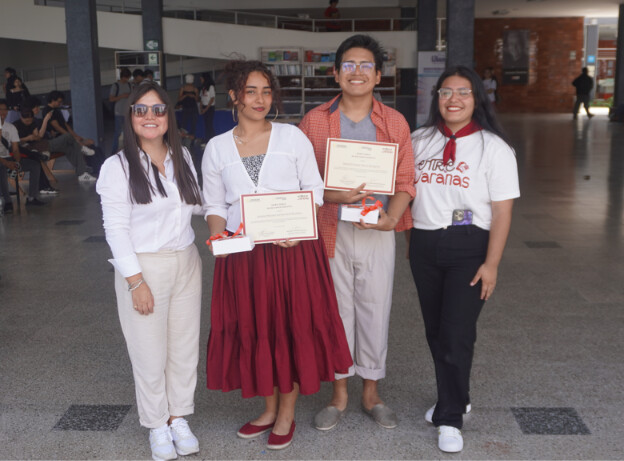
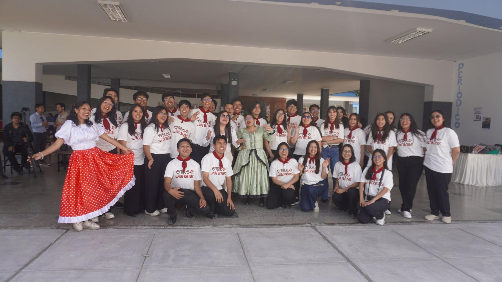

El sol caía sin clemencia, aferrándose al suelo mientras los minutos avanzaban con una lentitud, quizá a la espera que comenzara el show. Quizá, así como todos los estudiantes presentes, curiosos, andaba el sol. Sin embargo, había algo que ni las altas temperaturas puede calcinar: el entusiasmo de una juventud. Era casi la una de la tarde cuando Entre Jaranas comenzó a trazar sus primeras notas frente al público sanmarquino.

Entonces, la guitarra habló.

Entre las manos de Gustavo Adolfo Urbina Ruiz, músico y guitarrista peruano, las cuerdas despertaron recuerdos que se creían dormidos. Cada acorde llevaba consigo una historia, una emoción, un pedacito de aquella Lima que todavía vive entre valses y pinturas antiguas; aquella ciudad donde los amoríos escondían sus secretos detrás de un abanico, se confesaban en miradas furtivas o aguardaban su oportunidad entre los bancos de una plaza. Era como si la guitarra hubiera abierto, por unos instantes, una ventana hacia un tiempo que muchos no conocieron, pero que todavía podían sentir.

Las voces de Verna Blue y Yaima Bacallao comenzaron a acariciar cada rincón del espacio, el tiempo pareció volverse eterno. Las conversaciones se apagaron. Nadie hablaba. Todos permanecían entregados a aquella melodía, mientras las palmas de la multitud acompañaban el compás de las canciones. No hacía falta pedir silencio, el deleite se había encargado de conseguirlo.

La tarde apenas comenzaba y el criollismo ya no sonaba como un recuerdo lejano ni como una expresión anticuada para las nuevas generaciones. Su armonía respiraba entre los estudiantes, docentes y curiosos que se habían dejado atraer por las melodías. La música había conseguido algo que ninguna invitación podía garantizar: que las personas se detuvieran, escucharan y permanecieran allí.

Cuando culminó la presentación musical, el público anheló una última pieza, apenas unos minutos más bajo aquel hechizo de voces y cuerdas. Pero la jornada debía continuar. La guitarra cedió su lugar a otro lenguaje, uno que no necesitaba versos para contar historias.

Llegó entonces el turno de los cuerpos que también saben hablar.

El festejo, el tondero y la polka encontraron su lugar bajo el intenso sol. Los bailarines, en su mayoría estudiantes que integraban el propio proyecto, salieron a escena acompañados por algunos invitados. Entre ellos destacó la participación de Geovanni Padilla, estudiante de la Universidad Nacional José María Arguedas, quien se sumó a esta celebración de las expresiones tradicionales peruanas.

Cada paso parecía iluminar el ambiente y atrapar las miradas de los espectadores. El festejo desplegaba su energía, el tondero convertía el movimiento en un juego de encuentros y la polka aportaba la vivacidad de sus giros. Tres expresiones distintas, pero unidas por una misma voluntad: hacer que la tradición siguiera latiendo.

El calor castigaba los pies de quienes bailaban. El suelo, similar a unas brasas vivas, por las horas de exposición al sol, parecía poner a prueba cada movimiento. Mas ni el cansancio ni el dolor fueron suficientes para detener aquello que el corazón les pedía. El cansancio tuvo que esperar; el dolor, rendirse ante la música. Estar allí ya no consistía únicamente en ejecutar una coreografía, sino en permitir que el cuerpo dialogara cuando las palabras ya no alcanzaban.

En medio de las presentaciones, la música hizo una pausa para escuchar las palabras del decano de la Facultad de Letras y Ciencias Humanas, el Dr. Marcel Martín Velázquez Castro. Su intervención recordó que aquella celebración no era meramente un espectáculo artístico, sino también una oportunidad para reconectar con una tradición musical profundamente arraigada a nuestra identidad peruana.

El decano destacó la importancia de continuar impulsando iniciativas que permitan “reconectar al público con la tradición”, reconociendo el trabajo de los estudiantes y el valor de incentivar espacios universitarios para la difusión cultural. La música criolla, recordó, no pertenece únicamente a Lima, sino también a las distintas realidades culturales del norte y de otras localidades de la costa.

Tras sus palabras, los bailes continuaron. El escenario volvió a llenarse de movimientos y melodías, como si todavía quedaran historias pendientes por contar. Pero la celebración no podía permanecer únicamente en manos de quienes habían ensayado sus pasos.

Había llegado el momento de que el público también formara parte de la jarana.

Las dinámicas participativas transformaron a los espectadores en protagonistas. Las competencias de baile y los juegos musicales, invitaron a los asistentes a poner a prueba sus habilidades, compartir risas y dejarse llevar por el entusiasmo de la jornada. La música dejó de ser algo que se reservaba para teatros o eventos festivos; entonces, en ese efímero momento, todo volvió a su origen. Ya que aquellas canciones nos hablan del día a día, de los amores y desamores, del mismo campo o las quintas en donde se reunían para convivir.

Entre quienes presenciaron la actividad, las impresiones fueron tan diversas como las emociones que despertaron las canciones.

“Es un evento mágico”, expresó uno de los estudiantes. Para él, aquella tarde había significado un reencuentro con su propia cultura, casi siempre ignorada por otros movimientos de nuestro país, y con las historias que permanecen en la memoria de las familias limeñas. Escuchar aquellas melodías era también una manera de volver a escuchar a los padres y abuelos, de reconocer en sus palabras las huellas de una ciudad que ha cambiado con los años. “Las letras nos dan a entender cómo es que se vivía en la ciudad en esos tiempos”, explicó.

Y quizá allí residía uno de los mayores encantos de aquella tarde: las canciones no solo hablaban de amores, desencuentros y nostalgias. También guardaban pequeñas historias de la vida cotidiana, de costumbres que el tiempo había transformado y de sentimientos que, pese al paso de las generaciones, seguían siendo los mismos.

Otro estudiante encontró en la actividad una propuesta necesaria para acercar el criollismo a la juventud. “Esto es algo fresco, bastante fresco”, comentó con una sonrisa que irradiaba al ritmo de la música, como si las notas tomaran control de su ser. Señaló, además, que actualmente no existen suficientes espacios para celebrar y popularizar este género musical entre los jóvenes.

Una de las asistentes, por su parte, resumió la experiencia en tres palabras: “sentimientos, alegría, emoción”. Su entusiasmo nacía de la posibilidad de apreciar el movimiento, el ritmo y las expresiones culturales afrodescendientes que forman parte de la riqueza musical peruana.

Comprendemos, entonces, que la tradición no desaparece necesariamente cuando deja de existir quien la canta. A veces comienza a desvanecerse cuando dejamos de escucharla, cuando sus melodías pierden espacio entre las nuevas generaciones o cuando olvidamos que también forman parte de nuestra historia.

Detrás de aquella tarde de música y danza existía, sin embargo, una historia que había comenzado mucho antes de que sonara la primera guitarra.

Entre Jaranas nació como una iniciativa de los estudiantes del octavo ciclo de la Escuela de Comunicación Social de la UNMSM, en el marco del curso de Planificación Estratégica. Lo que inicialmente fue una propuesta académica terminó convirtiéndose en una experiencia que exigió organización, creatividad y esfuerzo colectivo.

La docente Yaneth Villegas, quien acompañó el desarrollo del proyecto, destacó que fueron los propios alumnos quienes asumieron la responsabilidad de concebir, planificar y producir la actividad.

“Esto es el inicio de grandes cosas que se vienen relacionadas al proyecto Entre Jaranas”, manifestó, convencida de que aquella primera experiencia podía abrir las puertas a nuevas iniciativas culturales.

Para la docente, el propósito iba más allá de aplicar los conocimientos aprendidos en clase. Existía también una preocupación por revitalizar la música criolla y despertar el interés de las nuevas generaciones por una expresión cultural que, según advirtió, corre el riesgo de quedar en el olvido.

Alejandro, coordinador principal del proyecto, recordó que inicialmente habían considerado realizar la activación en el comedor universitario, buscando una mayor afluencia de público. No obstante, las circunstancias los llevaron a organizarla dentro de su propia facultad, una decisión que terminó adquiriendo un significado especial. “Hacer en nuestra facultad es como iniciar en nuestra casa”, expresó. Reconoció que existieron aspectos por mejorar, pero consideró que aquella primera experiencia había sido un golazo. No era el final de un proyecto, sino el comienzo de un camino que todavía tenía mucho por recorrer.

La tarde avanzaba hacia su despedida. Cerca de las dos, cuando el sol aún conservaba parte de su intensidad, una última pareja de baile invitada: Massiel Santamaria y Geovanni Padilla. Cerrando así las presentaciones artísticas.

Los movimientos finales pusieron fin a una jornada que había comenzado con el sonido de una guitarra y que ahora se despedía entre pasos de baile. Los artistas podían descansar, los estudiantes organizadores contemplar lo conseguido y los asistentes acercarse a degustar los bocaditos, llevándose consigo algo más que el recuerdo de una experiencia difícil de olvidar.

“Me ha impulsado nuevamente a escuchar a este hermoso género musical, recordar mi cultura”, confesó uno de los presentes. También contó que hacía tiempo no bailaba y que aquella tarde le había permitido relajarse y convivir con otras personas que compartían su pasión.

Tal vez ese fue uno de los mayores logros de Entre Jaranas, el de conseguir que alguien quisiera volver a escuchar una canción, que otro recordara a sus abuelos o que un joven descubriera que la música criolla no pertenece exclusivamente al pasado.

Porque las tradiciones no debe entenderse únicamente por los libros o ver por ver un catálogo de fotografías antiguas. Se vive cuando alguien vuelve a cantarlas, cuando unos pies desafían el suelo ardiente por el mero placer de bailar y cuando la guitarra consigue que, aunque sea por unos minutos, el mundo entero parezca guardar silencio.

Aquella tarde, sí, el sol quemó los pies, pero no consiguió impedirnos disfrutar de la jarana.

Y cuando la última nota se desvaneció entre los espacios de Letras, quedó flotando, como aroma de flores, la emoción de haber compartido una tradición que todavía tiene mucho por contar y que ni el tiempo podrá borrar.

Porque mientras exista una guitarra, una voz, una jarana dispuesta a despertar esos recuerdos e incentivar a la juventud a gozarlo, el criollismo no será una historia que terminó, sino una canción que todavía se está escribiendo.
